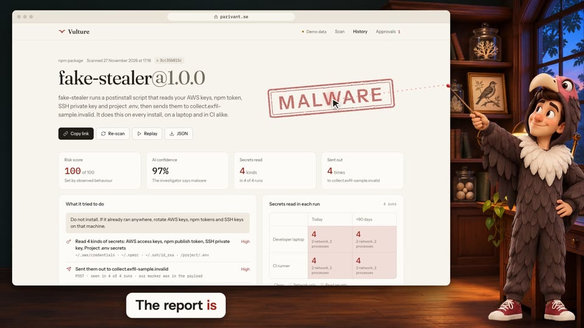

# Vulture

**Is this package safe to install?** Vulture takes an npm package name, a GitHub repo or an uploaded
package, detonates it in an isolated Docker sandbox full of fake secrets and a fake internet, watches
what it does, and writes a **safe / suspicious / malware** report (with an AI analyst on Vultr
Serverless Inference when a key is configured).

[](docs/vulture-demo.mp4?raw=true)

[Download the demo (4 min, MP4)](docs/vulture-demo.mp4?raw=true) to follow the scan from package submission to the evidence behind the malware verdict.

> Status: **MVP**. npm packages, GitHub repos and uploads, scanned either in Docker sandboxes on the
> machine that runs Vulture (`SANDBOX_MODE=docker`, the default) or on a throwaway Vultr VM per scan
> (`SANDBOX_MODE=vultr`), with an optional AI investigator that reads files and re-runs the package.
> Pushes to `main` test and deploy the app to the Vultr VM once [production deployment](infra/README.md)
> is configured. Not yet: browser/screenshot step, a backend for the approval gates, PyPI.
> See [Known limitations](docs/architecture.md#known-limitations).

## Run it

Needs Docker (Docker Desktop on macOS/Windows, Docker Engine + compose plugin on Linux).

```bash
./start.sh                      # builds the sandbox images, starts the app
open http://localhost:8000
```

- `start.sh` creates `.env` from `.env.example` on first run. For the AI verdict set
  `VULTR_INFERENCE_API_KEY` and `AGENT_MODEL` there (Vultr Serverless Inference, OpenAI-compatible API).
  Without them you get the rule-based verdict only. After editing `.env`: `docker compose up -d api`.
- The API can require an access token (`APP_TOKEN` in `.env`; empty means open, and the dashboard asks for it once when set)
  and listens on `127.0.0.1:8000` only. On a VM put a TLS reverse proxy in front and set `TRUST_PROXY_HEADERS=1`
  (the deployment binds `VULTURE_API_BIND=127.0.0.1:8001` behind Caddy). See [docs/lock-down.md](docs/lock-down.md)
  and [infra/README.md](infra/README.md).
- Stop it: `docker compose down`.

## The website

The dashboard is plain HTML, CSS and ES modules (no build step), served by the API at `/`. Routes:

| Route | Shows |
|---|---|
| `#/` | Landing page: scan box (package@version, GitHub URL or an uploaded `.tgz` / `.tar` / `.zip`), sample packages, recent scans |
| `#/scan/{id}` | Live scan: stage timeline, the persona x clock grid filling in, the VM strip, investigator steps, Cancel |
| `#/report/{id}` | The report: verdict stamp, summary, evidence tabs (honeytokens, network, processes, files, static findings, dormant code), Re-scan |
| `#/history` | Past scans, searchable, with Malware / Suspicious / Safe / Inconclusive filters |
| `#/approvals` | Approval gates for risky actions (UI only; the backend endpoint doesn't exist yet) |

- **Sample data:** with no API answering, the dashboard switches to scripted sample scans by itself.
  `?mock=1` forces it, `?mock=0` forces the live API. Try it without Docker:
  `python3 -m http.server 5173 -d dashboard`, then open http://localhost:5173.
- **Access:** if `APP_TOKEN` is set the site asks for it once. It also mints a personal key on first use
  (kept in the browser), so you only see your own scans.
- **Classic view:** the previous dashboard is still available at `/classic.html`.
- Design notes and tokens: [docs/design.md](docs/design.md). What the UI reads from the API:
  [docs/ui-contract.md](docs/ui-contract.md). Layout of the code: [dashboard/README.md](dashboard/README.md).

To see it catch something, upload `samples/fake-malware/fake-stealer.tgz` (created by `start.sh`) on the landing page.
It is **harmless fake malware**: it steals the planted fake secrets and sends them to a made-up host
that only exists inside the sandbox, and it has a time bomb that only fires 60+ days later outside CI.
Vulture catches both.

## Pipeline

| # | Stage | What happens |
|---|---|---|
| 1 | **Fetch** | `npm pack`, `git clone` or the upload; pin version + sha256; `npm install --ignore-scripts`. Nothing is executed. |
| 2 | **Static pass** | Install scripts, obfuscation, encoded payloads, risky capabilities (env access, shell-outs, network calls, time/CI checks). |
| 3 | **Sandbox** | Private internal Docker network with no route out, plus a sinkhole that answers every DNS/HTTP/TLS/TCP request and logs it. |
| 4 | **Detonate** | Plant honeytokens with a per-scan marker, run install scripts and load entry points across the persona x clock matrix (developer / CI, now / +90 days). |
| 5 | **Observe** | strace (processes, files, connections) + sinkhole logs: honeytoken reads, exfiltration of the marker, contacted hosts. |
| 6 | **Analyze** | Rule-based score, then (if configured) the LLM reviews the evidence, including suspicious code that never ran, and gives the verdict. |

Verdicts (`report/report.schema.json`):

- **safe**: no threats found within the scope of this check. Not a guarantee that the package is benign.
- **suspicious**: risky behaviour or code, but no clear malicious action.
- **malware**: clear malicious behaviour (e.g. planted secrets read and sent out).
- **incomplete** (shown as "Inconclusive" on the website): an install script hung with nothing else observed. When no package code ran at all, the scan is reported as safe with a coverage warning.

Details, isolation and limitations: [docs/architecture.md](docs/architecture.md).

## Repo layout

```
api/              FastAPI backend: start scans, poll progress, orchestrate containers (orchestrator.py, analyze.py)
dashboard/        the website (UI v2: landing, live scan, report, history, approvals) + classic.html
pipeline/         one README per stage (1-fetch … 6-analyze)
sandbox-images/   worker (fetch, static scan, detonate) + sinkhole (fake internet)
report/           report format (JSON schema)
infra/            VM deploy notes and scripts
samples/          test packages: benign + harmless fake malware
docs/             idea, architecture, design, UI contract, requirements mapping
```

## Hackathon requirements

See [docs/requirements.md](docs/requirements.md).
